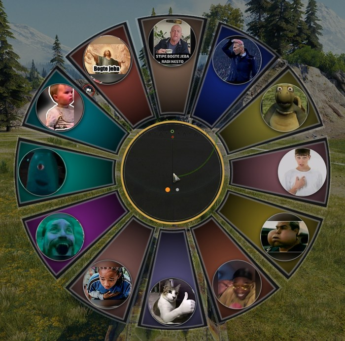
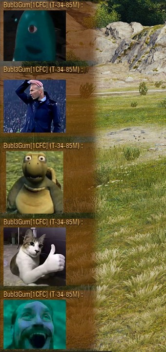
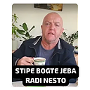
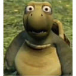
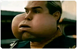
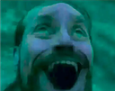
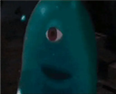
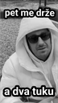

# StipeSticker

Stickers in World of Tanks chat. Type a sticker code in chat, and players who also have StipeSticker see the picture instead of the code.

Works in battle chat, platoon chat, clan chat and private messages.

For game version **2.4.1.0** (EU).

## Screenshots

| Sticker wheel (hold V in battle) | Stickers in battle chat |
|---|---|
|  |  |

## Installation

1. Download the latest version (`stickers.stipesticker_X.Y.Z.wotmod`) from **[Releases](https://github.com/Bubl3Gum/world-of-tanks-chat-stickers/releases/latest)**.
2. Put it in `World_of_Tanks_EU\mods\2.4.1.0\`.
3. If you have an older version of StipeSticker, delete it from the same folder.
4. Start the game.

## Usage

- Type a sticker code (`:stk7:`), its shortcut (`S7`) or its name (`/ok`) in chat.
- In battle, hold **V** for the sticker wheel and pick one (two pages). It is sent to the channel you selected with Tab (team or platoon).
- Stickers are sent by name, so players without the mod see the name (e.g. `/mbape`).

## Stickers

| # | Picture | Name | Code | Shortcut | Name in chat |
|---|---|-----|-----|---------|-------------|
| 1 |  | stipe | `:stk1:` | `S1` | `/stipe` |
| 2 |  | zidane | `:stk2:` | `S2` | `/zidane` |
| 3 |  | mbape | `:stk3:` | `S3` | `/mbape` |
| 4 |  | ja | `:stk4:` | `S4` | `/ja` |
| 5 |  | uff | `:stk5:` | `S5` | `/uff` |
| 6 |  | gas | `:stk6:` | `S6` | `/gas` |
| 7 |  | ok | `:stk7:` | `S7` | `/ok` |
| 8 |  | boli | `:stk8:` | `S8` | `/boli` |
| 9 |  | arty | `:stk9:` | `S9` | `/arty` |
| 10 |  | au | `:stk10:` | `S10` | `/au` |
| 11 |  | sta | `:stk11:` | `S11` | `/sta` |
| 12 |  | bogtejeba | `:stk12:` | `S12` | `/bogtejeba` |
| 13 |  | zalazak | `:stk13:` | `S13` | `/zalazak` |
| 14 |  | kita | `:stk14:` | `S14` | `/kita` |
| 15 |  | dvatuku | `:stk15:` | `S15` | `/dvatuku` |
| 16 |  | stai | `:stk16:` | `S16` | `/stai` |
| 17 |  | znamo | `:stk17:` | `S17` | `/znamo` |
| 18 |  | kasnim | `:stk18:` | `S18` | `/kasnim` |
| 19 |  | jbg | `:stk19:` | `S19` | `/jbg` |

Since version 0.9.0 stickers are sent by name (`/zidane`) instead of by number, so everyone you play with needs 0.9.0 or newer to see your stickers. The old names `/kurcina` and `/pjebiga` still work.

## Updates

Every time you log in, the garage notification list has a StipeStickers notice with your version:

- **Up to date** (green) – you have the latest version.
- **New version available** (orange) – a new version is out.
- The small circle next to the version checks again for a new version.
- The **SHOW** button opens the StipeStickers window: installed version, status, what's new, and a **DOWNLOAD** button that opens the new version here on GitHub. The window can be moved by dragging its title bar.

While you don't have the latest version, the window opens by itself every time you log in.

The mod never downloads or installs anything by itself: you download the new version and replace the old one yourself.
