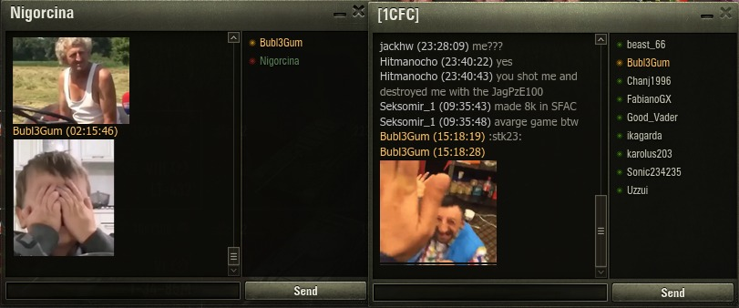
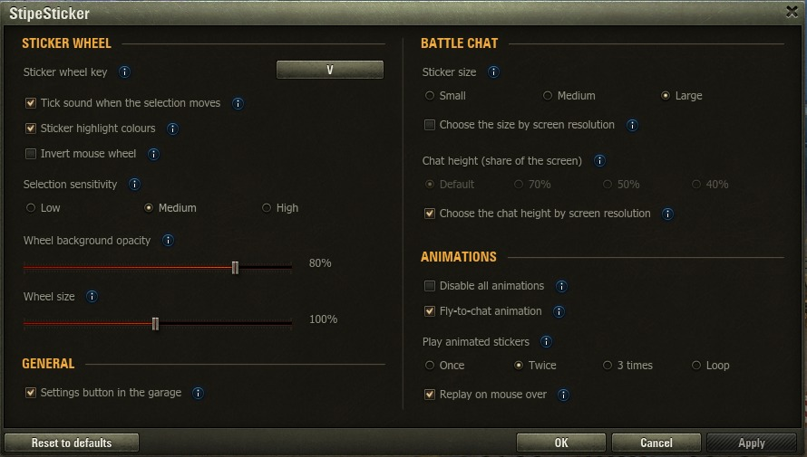
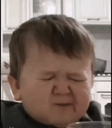
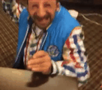

# StipeSticker

**Stickers in World of Tanks chat – now with animated stickers**

 

Type a sticker name in chat and everyone with StipeSticker sees the picture. Works in battle, platoon, clan and private chat. Players without the mod only see a short code like `:stk2:`.

## Installation

1. Download the `.wotmod` from **[Releases](https://github.com/Bubl3Gum/world-of-tanks-chat-stickers/releases/latest)**
2. Put it in `World_of_Tanks_EU\mods\2.4.1.1\` and delete any older version
3. Start the game

Nothing else is needed – no other mods required.

## Usage

- Type `/name` in chat, e.g. `/zidane` (`s2` and `:stk2:` work too)
- In battle, hold **V** for the sticker wheel, move the mouse to a sticker and release
  - right click or the mouse wheel flips the page
  - it sends to the chat you picked with Tab (team or platoon)
  - the red ring around the centre shows the chat cooldown – wait until it is full before sending again
- Animated stickers play twice and then stop – hover or click them to play them again (both can be changed in the settings)

> Everyone needs **1.0 or newer** to see the animated stickers.

## Settings

Click the sticker icon next to the gear in the bottom right corner of the garage. Every option has an info icon that explains it, and **Reset to defaults** brings everything back.

**Sticker wheel**
- **Sticker wheel key** – click it and press a new key
- **Tick sound** and **sticker highlight colours**
- **Invert mouse wheel** – turns the page flip direction around
- **Selection sensitivity** – Low, Medium or High
- **Wheel background opacity** and **wheel size**

**Battle chat**
- **Sticker size** – Small (96 px), Medium (128 px) or Large (160 px)
- **Chat height** – how much of the screen the battle chat may use; older messages are hidden when it is full
- Both can follow your screen resolution automatically (on by default)

**Animations**
- **Disable all animations** – every sticker stays still and the wheel opens without animation
- **Fly-to-chat animation**
- **Play animated stickers** – once, twice, 3 times or in a loop
- **Replay on mouse over**

**General**
- **Settings button in the garage** – can be hidden if you use the mods menu

If you use the mods menu (modsSettingsAPI), the same settings are there too. Settings are saved in `mods\configs\stipesticker\stipesticker.json`.

## Stickers

### Animated

<table>
<tr><td align="center"> <code>/deal</code></td><td align="center"> <code>/brt</code></td><td align="center"> <code>/bravo</code></td></tr>
</table>

### Classic

<table>
<tr><td align="center"> <code>/stipe</code></td><td align="center"> <code>/zidane</code></td><td align="center"> <code>/mbape</code></td><td align="center"> <code>/ja</code></td><td align="center"> <code>/uff</code></td></tr>
<tr><td align="center"> <code>/gas</code></td><td align="center"> <code>/ok</code></td><td align="center"> <code>/boli</code></td><td align="center"> <code>/arty</code></td><td align="center"> <code>/au</code></td></tr>
<tr><td align="center"> <code>/sta</code></td><td align="center"> <code>/bogtejeba</code></td><td align="center"> <code>/zalazak</code></td><td align="center"> <code>/kita</code></td><td align="center"> <code>/dvatuku</code></td></tr>
<tr><td align="center"> <code>/stai</code></td><td align="center"> <code>/znamo</code></td><td align="center"> <code>/kasnim</code></td><td align="center"> <code>/jbg</code></td></tr>
</table>

## Compatibility

- Works together with XVM and Aslain's modpack
- StipeSticker changes a few WoT interface files (clan, private, platoon and battle chat and the garage footer), so after a game update wait for a new StipeSticker version

## Updates

When a new version is out, the garage notification says **New version available**. Click **SHOW** → **DOWNLOAD**, then replace the old file yourself. The mod never downloads anything on its own.
